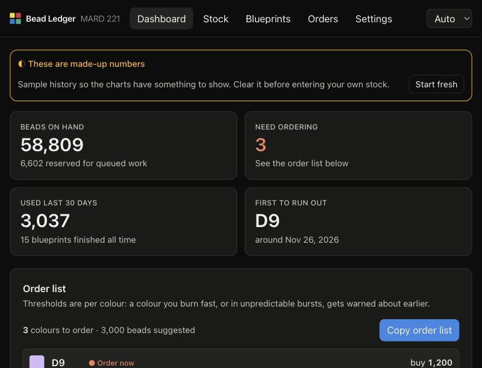
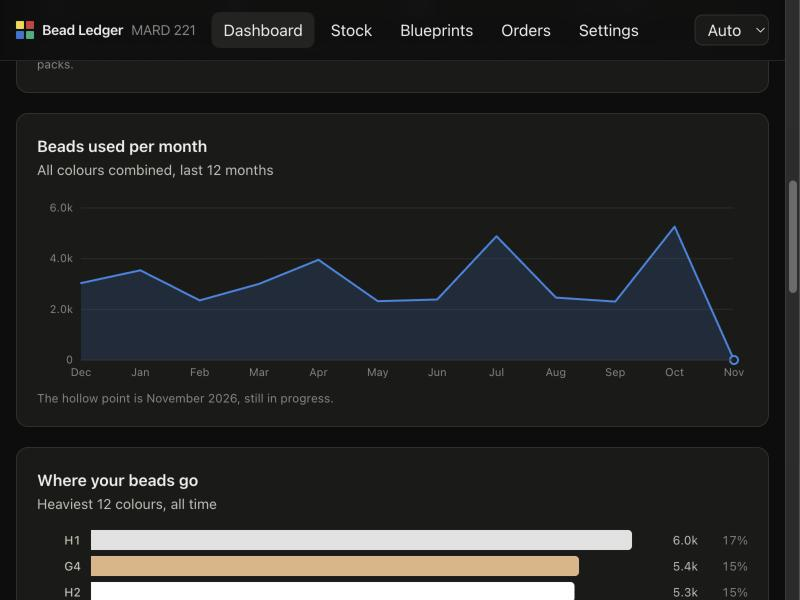
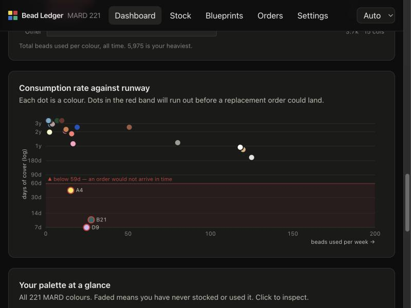

# Bead Ledger

Stock and consumption tracking for fuse beads (拼豆 / perler), built around the
**MARD 221** palette.

It answers one question well: *what do I need to order, and how much, given that
a resupply takes six weeks to arrive from China?*



<sub>Every number in these screenshots is fabricated sample data (`npm run seed`).</sub>

- **Stock** — what you have, derived from an append-only ledger, so every number
  traces back to a dated event.
- **Blueprints** — queue what you plan to build (its beads get reserved) and log
  what you finished, including **colour substitutions** when you deviated from
  the chart.
- **Orders** — record deliveries; that is the only thing that adds stock.
- **Reorder advice** — a per-colour threshold computed from your own history. A
  colour you tear through, or use in unpredictable bursts, gets flagged earlier
  than one you dab on.
- **Charts** — monthly consumption, where your beads actually go, and a runway
  plot of every colour you stock.



Your data is a single JSON file in `data/`. Nothing is sent anywhere, and there
is no account, no telemetry and no network call.

## Running it

Needs **Node 18 or newer**. Nothing else.

```bash
git clone https://github.com/KyleWei-UChi/bead-ledger.git
cd bead-ledger
npm install
npm run seed     # optional: a fabricated year of history to look around
npm run dev
```

Then open **http://localhost:5178**. Two processes start: Vite on 5178 and a
small data server on 8787 that owns `data/beads.json`.

For everyday use rather than development, build once and run one process:

```bash
npm run build
npm start        # http://localhost:8787
```

**On macOS** you can skip the terminal entirely after setup:

```bash
npm run app
```

That builds **Bead Ledger.app** into `~/Applications` — double-click it or drag
it to the Dock, and it starts the server, rebuilds if the code changed, and
opens your browser. (macOS only; it is an AppleScript applet wrapping the same
commands.)

**[RUNNING.md](RUNNING.md)** covers all of this properly, plus the optional
hosted copy and how to move data between the two.

## How the reorder threshold works

Stock levels alone are a bad trigger — 500 beads is months of a colour you use
for highlights and a fortnight of your main outline black. So each colour gets
its own reorder point, in `src/domain/forecast.ts`:

```
protection period  = lead time + safety buffer          (default 45 + 14 days)
burn rate          = beads consumed ÷ history window    (default 180 days)
weekly σ           = standard deviation of weekly use
safety stock       = z(service level) × σ × √(protection ÷ 7)
reorder point      = burn rate × protection + safety stock
```

Two consequences, both deliberate:

- **Faster colours get higher thresholds.** The first term scales with burn rate.
- **Lumpier colours get higher thresholds too.** Two colours averaging the same
  beads per week get different reorder points if one is used steadily and the
  other in occasional large batches — the σ term catches that. This is the
  classic safety-stock formula, and it is the reason the app does not just use a
  flat "warn me at 500".

A colour is `short` when queued blueprints already exceed stock, `order` at or
below its reorder point, `watch` within 1.5× of it, `ok` above.



Each dot is a colour: how fast you use it against how long your stock lasts.
The red band is the protection period — anything inside it runs out before a
replacement could land, however much is left on the shelf.

Suggested order quantities top you back up to roughly `targetCoverDays` of use,
rounded to whole packs, because placing an overseas order is the expensive part.

## Data model

Stock is never stored, only derived. `data/beads.json` holds:

| key | what it is |
|---|---|
| `ledger` | append-only `opening` / `restock` / `consume` / `adjust` entries |
| `blueprints` | plan (the chart's legend), actual (what you used), substitutions |
| `orders` | deliveries, linked to the ledger entries they created |
| `colorMeta` | your names and hex corrections, per colour |
| `settings` | lead time, buffers, service level, pack size |

Re-finishing a blueprint replaces its consumption rather than double-counting;
reopening one refunds it. Both are covered by tests.

## The palette

`src/palette/mard221.ts` holds all 221 codes: A26 B32 C29 D26 E24 F25 G21 H23
M15. The **codes and series sizes are authoritative**; the **hex values are
approximations** taken from public bead-palette references, which disagree with
each other by a few percent. MARD publishes no official digital chart, so
treat the colours on screen as identification aids, not colour matching.

Correct any that look wrong under Settings → Palette corrections. Your override
is stored in your own data file, not in the palette module, so it survives
updates. Corrections that are clearly right are welcome as pull requests.

This project is not affiliated with, endorsed by, or connected to MARD. The
palette codes are referenced for interoperability with charts that use them.

## Optional: running it as a hosted page

The same code can run against a [Claude Artifact](https://claude.ai) database
instead of the local file server, which gives you a private page you can open
on a phone:

```bash
npm run build:artifact
```

Storage is behind one small interface (`src/store/types.ts`) with two
implementations, so neither copy is privileged. The local file remains the
reference copy; the hosted one is a convenience.

**They are separate stores and do not sync.** Nothing moves between them except
a JSON file you export and import yourself. [RUNNING.md](RUNNING.md) explains
why, and which one to treat as the real copy.

## Tests

```bash
npm test
```

Covers the palette's integrity, ledger arithmetic, substitution handling, legend
parsing, and the forecasting properties above.

## Layout

```
server/index.mjs        zero-dependency data server, atomic writes + backups
src/domain/             types, inventory, forecast, actions — no React in here
src/store/              storage adapters (local file, Artifact db)
src/components/         UI; charts/ holds hand-rolled SVG
src/palette/mard221.ts  the 221 colours
scripts/seed-demo.mjs   fabricated history for trying the app out
```

The domain layer is deliberately free of UI so the arithmetic can be tested and
reused.

## Contributing

Issues and pull requests are welcome, particularly palette hex corrections and
support for other bead brands' code systems. The domain layer has tests; please
keep them passing (`npm test`).

## Licence

[MIT](LICENSE).
